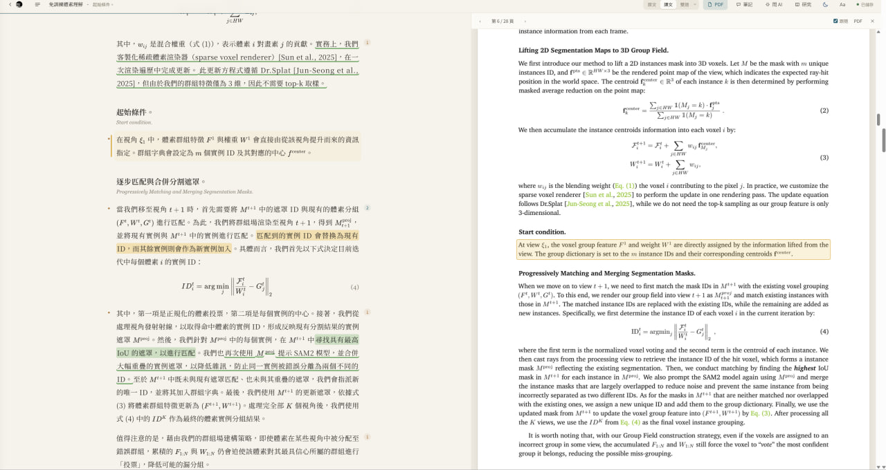
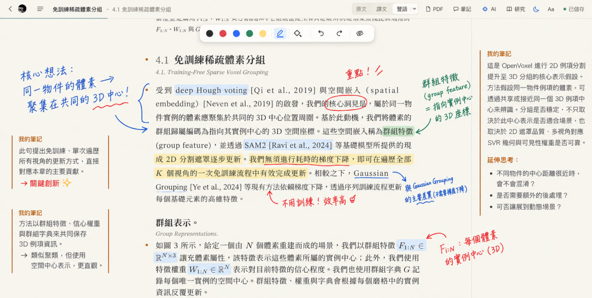
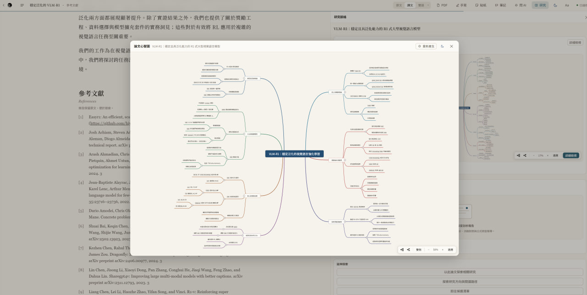

<p align="center"></p>

# NewsRead

A personal reading workspace for Taiwan and US market news, adapted from [PaperRead](https://github.com/YuriyLin/PaperRead).

[繁體中文](README.md) · [Report an issue](https://github.com/shaun0457/NewsRead/issues)


> **Status**: in development. There is no packaged installer and no automatic update yet; run it from source or with Docker.

NewsRead keeps the PaperRead reader (built on EasyRead) and brings reading, source verification, and notes into one local workspace. Literature search, the reading board, reading paths, deep analysis, Zotero migration and bulk import were removed (NewsRead ticket 04).



## Why NewsRead?

Search results, reading progress, and research notes often live in separate tools. NewsRead helps you stay connected to the original paper and carry your work into your own knowledge base.

## Three modules

### 01 · Read & Annotate

Read translations alongside the original and capture your thoughts.



| Feature | Purpose |
| --- | --- |
| Tabs and split view | Switch between or compare papers side by side |
| Bilingual reading and page lightbox | Check text, formulas, figures, and original pages |
| Ink and text boxes | Annotate, select with a lasso, and group objects |
| Reading notes | Write in rich text or Markdown |

### 02 · Analyze & Connect

Go deeper into a paper, with the source close at hand.



| Feature | Purpose |
| --- | --- |
| Cross-paper search | Search originals and translations and jump to passages |
| Mind maps and AI chat | Explore structure and ask questions about a paper |

### 03 · Build Your Knowledge Base

Keep your work in files you can continue to use.

| Feature | Purpose |
| --- | --- |
| Obsidian export | Export notes, annotations, and mind maps with WikiLinks |
| Markdown and JSON | Organize, back up, and manage research data |

## AI model support

| Type | Supported options |
| --- | --- |
| Local CLI | Antigravity CLI, Claude Code, Codex CLI |
| Cloud APIs | OpenAI, Claude, Gemini, DeepSeek, and others |
| Local models | Ollama, LM Studio |

AI is optional. Library management, PDF reading, ink annotations, and knowledge organization work without a configured model. Translation, AI chat, and analysis require one.

## Installation

There is no packaged installer yet. To run from source, see the [contributing guide](CONTRIBUTING.md). Docker browser edition:

```bash
git clone https://github.com/shaun0457/NewsRead.git
cd NewsRead
docker compose up -d
```

Open http://localhost:8765. See the [contributing guide](CONTRIBUTING.md) for development and running from source.

NewsRead keeps running in the background after you close its pages, so scheduled work keeps going; only one copy runs per data directory. If you started it with `start.cmd`, stop it with `.venv\Scripts\easyread stop` (`start.sh` on macOS / Linux: `.venv/bin/easyread stop`); it shows up as `pythonw.exe` in Task Manager. On Windows, `.venv\Scripts\easyread autostart on` starts it when you sign in (`off` to undo).

In the Windows installer, closing the window keeps NewsRead in the system tray, still fetching and running schedules; choose Quit from the tray to stop it. Start at login is under Settings → Background (it starts in the tray). If a service started with `start.cmd` is already running, the desktop app uses that service and leaves it running when you quit.

## Data & privacy

The library is stored locally by default: `C:\Users\<user>\PaperRead` on Windows and `~/PaperRead` on macOS/Linux. Papers and annotations are stored as JSON and other files you can back up or manage with Git. Cloud models, and importing a paper by DOI or title (which queries Semantic Scholar / arXiv), send relevant content to the selected services; choose them according to your needs.

## Documentation & contribution

- [User guide](docs/index.html) · [System design](docs/design.md) · [Data format](docs/data-format.md) · [API](docs/api.md) · [Changelog](CHANGELOG.md)
- [Contributing](CONTRIBUTING.md) · [Issues and suggestions](https://github.com/shaun0457/NewsRead/issues)

Contributions, bug reports, and feedback on research workflows are welcome.

## License & credits

The code is licensed under the [MIT License](LICENSE) and builds on [EasyRead](https://github.com/Edwardxlai/easyread).
