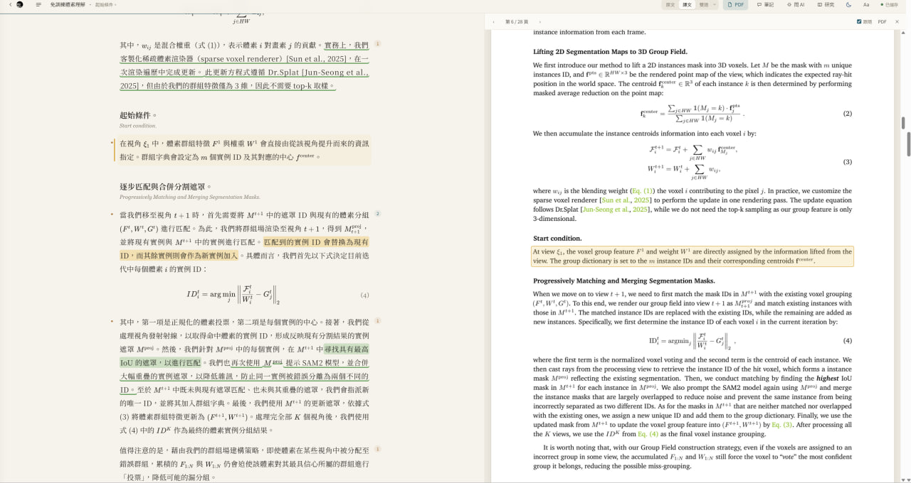
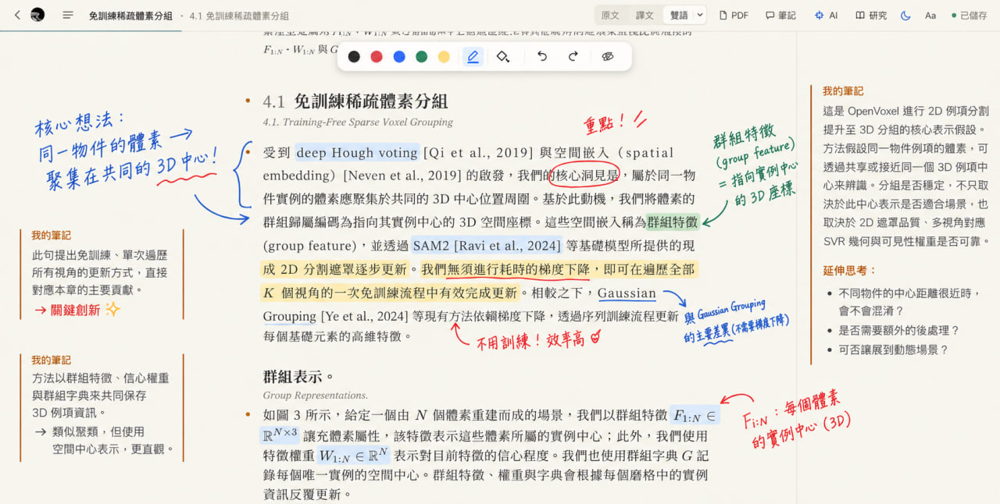
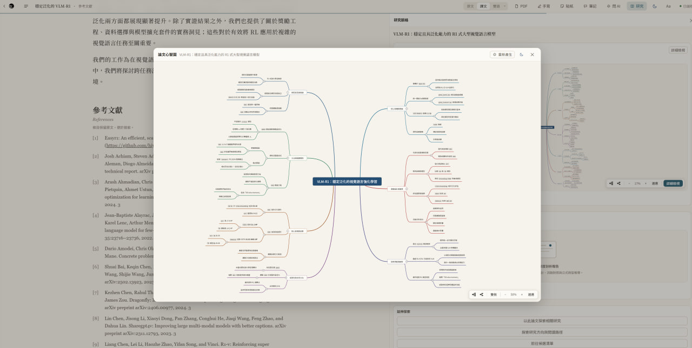

<p align="center"></p>

# NewsRead

台股、美股市場資訊的個人閱讀工作區，由 [PaperRead](https://github.com/YuriyLin/PaperRead) 改造而來。

[English](README.en.md) · [回報問題](https://github.com/shaun0457/NewsRead/issues)


> **狀態**：開發中，還沒有打包好的安裝程式，也沒有自動更新；請從原始碼或 Docker 執行。

NewsRead 沿用 PaperRead（建立於 EasyRead 之上）的閱讀器，將對照原文和整理筆記放進同一個本機工作區。文獻搜尋、閱讀看板、閱讀路徑、深度剖析、Zotero 遷移和成批導入已移除（NewsRead ticket 04）。



## 為什麼選擇 NewsRead？

搜尋結果、閱讀進度和研究筆記常散落在不同工具。NewsRead 讓你保留原文脈絡，並將閱讀成果帶入自己的知識庫。

## 三個模組

### 01 · Read & Annotate

對照譯文與原頁，在閱讀時保留自己的想法。



| 功能 | 用途 |
| --- | --- |
| 多分頁與雙開 | 切換或並排閱讀不同論文 |
| 雙語閱讀與原頁燈箱 | 對照原文、譯文、公式與圖表 |
| 手寫與文字方塊 | 自由標註、套索複選與群組 |
| 閱讀筆記 | 以富文字或 Markdown 整理內容 |

### 02 · Analyze & Connect

從單篇理解延伸，並回到原文核對。



| 功能 | 用途 |
| --- | --- |
| 跨論文檢索 | 搜尋原文及譯文並定位段落 |
| 心智圖與問答 | 梳理結構並針對閱讀內容提問 |

### 03 · Build Your Knowledge Base

將閱讀成果保存在可持續使用的檔案中。

| 功能 | 用途 |
| --- | --- |
| Obsidian 匯出 | 結構化匯出筆記、標註與心智圖，建立 WikiLinks |
| Markdown 與 JSON | 整理、備份及管理研究資料 |

## AI 模型支援

| 類型 | 支援方式 |
| --- | --- |
| 本機 CLI | Antigravity CLI、Claude Code、Codex CLI |
| 雲端 API | OpenAI、Claude、Gemini、DeepSeek 等 |
| 本地模型 | Ollama、LM Studio |

AI 並非使用 NewsRead 的必要條件。未配置模型時，文獻管理、PDF 閱讀、手寫註記與知識整理等基礎功能仍可使用；翻譯、AI 問答與分析需要模型。

## 安裝

目前沒有打包好的安裝程式。從原始碼執行見 [貢獻指南](CONTRIBUTING.md)；Docker 瀏覽器版：

```bash
git clone https://github.com/shaun0457/NewsRead.git
cd NewsRead
docker compose up -d
```

開啟 http://localhost:8765。原始碼安裝與開發方式見 [貢獻指南](CONTRIBUTING.md)。

## 資料與隱私

文獻庫預設儲存在本機：Windows 為 `C:\Users\<使用者名稱>\PaperRead`，macOS／Linux 為 `~/PaperRead`。論文資料與註記使用 JSON 等檔案保存，可自行備份或以 Git 管理。使用雲端模型，或用 DOI／標題匯入論文（會查 Semantic Scholar／arXiv）時，相關內容會傳送至所選服務；請依需求選擇服務與模型。貼新聞連結匯入時，NewsRead 會直接連到那個網址抓頁面（不經過其他服務），不抓指向本機或內網的網址。

## 文件與參與

- [使用手冊](docs/index.html) · [系統設計](docs/design.md) · [資料格式](docs/data-format.md) · [API](docs/api.md) · [更新紀錄](CHANGELOG.md)
- [參與貢獻](CONTRIBUTING.md) · [回報問題與建議](https://github.com/shaun0457/NewsRead/issues)

歡迎提出問題、分享使用情境或協助改善閱讀與知識整理流程。

## 授權與致謝

程式碼採 [MIT License](LICENSE)，並以 [EasyRead](https://github.com/Edwardxlai/easyread) 為基礎。

## Star History

<a href="https://www.star-history.com/?repos=yuriylin%2Fpaperread&type=date&legend=top-left">
 <picture>
   <source media="(prefers-color-scheme: dark)" srcset="https://api.star-history.com/chart?repos=yuriylin/paperread&type=date&theme=dark&legend=top-left" />
   <source media="(prefers-color-scheme: light)" srcset="https://api.star-history.com/chart?repos=yuriylin/paperread&type=date&legend=top-left" />
   
 </picture>
</a>
